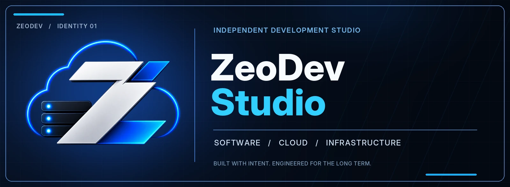
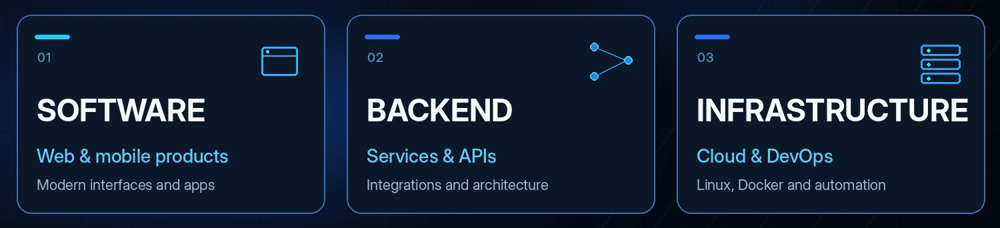
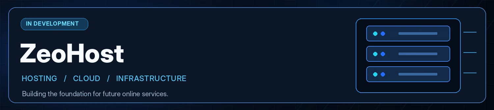
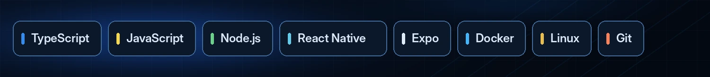

 

**Software engineering · Apps & APIs · Infrastructure**

Building thoughtful software and the systems behind it.

[Explore repositories](https://github.com/zeodev-studio?tab=repositories) &nbsp;·&nbsp; [ZeoHost](#zeohost) &nbsp;·&nbsp; [Technology](#technology)

 

## What we build

From product interfaces to backend services and deployment infrastructure — engineered to be practical, maintainable and ready to grow.

 

## ZeoHost

A hosting and infrastructure initiative currently in development, focused on reliable foundations for future online services.

 

## Technology

 

---

**ZeoDev Studio**  
*Design with purpose. Engineer for the long term.*

[GitHub](https://github.com/zeodev-studio) · [Repositories](https://github.com/zeodev-studio?tab=repositories)

