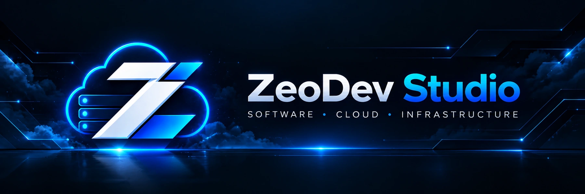

 

### Engineering software. Building what comes next.

**Applications · Web Platforms · APIs · Cloud Infrastructure · DevOps**

[**Explore our repositories →**](https://github.com/zeodev-studio?tab=repositories)

---

### About ZeoDev Studio

**ZeoDev Studio** is an independent software development brand focused on creating modern digital products and the infrastructure behind them.

From application interfaces and backend services to containerized deployments and server operations, our approach is built around thoughtful architecture, performance, security, and maintainability.

### What we focus on

| Software engineering | Cloud & infrastructure |
| :--- | :--- |
| Mobile and web applications | Linux servers and containerization |
| Backend services and APIs | Hosting infrastructure |
| Product architecture and integration | Deployment automation and DevOps |

### Currently building

**ZeoHost** — a hosting and infrastructure project in development, focused on creating a reliable foundation for future online services.

### Technologies & tooling

`TypeScript` · `JavaScript` · `Node.js` · `React Native` · `Expo` · `Docker` · `Linux` · `Git`

---

**ZeoDev Studio**  
*Build thoughtfully. Engineer for the long term.*

[GitHub profile](https://github.com/zeodev-studio) · [Repositories](https://github.com/zeodev-studio?tab=repositories)

